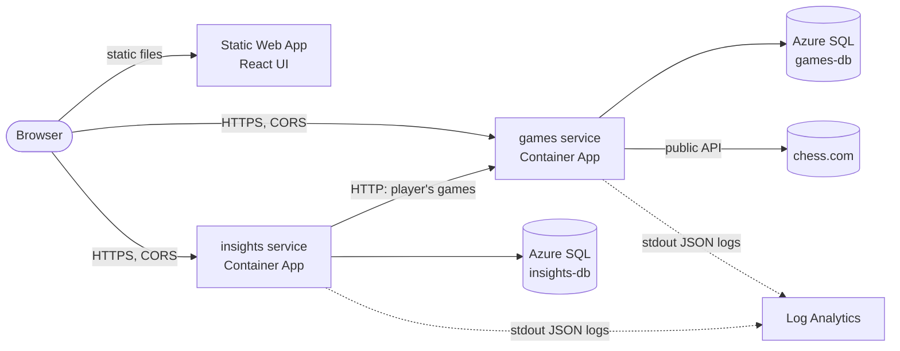

# Chess Habits

Chess Habits is a chess improvement platform. It collects data about **how you play** (your games, your clock, and optionally where you look on the board) and turns it into personal, evidence-based feedback on **what to train next**.

It is not another engine game review. See [docs/vision.md](docs/vision.md) for what makes it different and the open research questions.

## What it does today

1. Track a chess.com account and import its full game history (month by month, cached).
2. Run analyses across all games, per time control: a **clock profile** (how often you get into time trouble, from which move, whether it is self-inflicted, whether long thinks, the opening or a steady drain cause it, and how many won positions the clock took) and an **after-loss** card (do you requeue faster, do you play below your level, would a stop-loss rule help). Every comparison comes with its sample size, a 95% interval, the smallest effect the data could detect, and a correction for testing many things at once; Chess Habits says "not enough data" instead of guessing.

**Live URL:** _added after the first Azure deployment_ (see [docs/deployment.md](docs/deployment.md)).

## Architecture



| Part | Tech | Owns |
|---|---|---|
| [services/games](services/games) | Python 3.12, FastAPI, SQLAlchemy, Alembic | tracked accounts (CRUD), imported games |
| [services/insights](services/insights) | Python 3.12, FastAPI, SQLAlchemy, Alembic | analysis runs and findings |
| [ui](ui) | React, Vite, TypeScript | static UI |
| [infra](infra) | Bicep | all Azure resources |

Each service has its own database and applies its own versioned migrations on startup. If one
service (or chess.com) is down, the other keeps working and the UI shows a clear message.

## Run locally

Requires Docker.

```bash
cp .env.example .env          # set MSSQL_SA_PASSWORD (letters + digits, upper/lower/digit)
docker compose up --build
```

UI: http://localhost:5173 · games API: http://localhost:8001/docs · insights API: http://localhost:8002/docs

Without Docker, each service also runs on SQLite: see [services/games](services/games/README.md),
[services/insights](services/insights/README.md) and [ui](ui/README.md).

## Tests

```bash
cd services/games    && pip install -r requirements-dev.txt && pytest --cov
cd services/insights && pip install -r requirements-dev.txt && pytest --cov
cd ui && npm ci && npm run test:coverage
```

CI ([ci.yml](.github/workflows/ci.yml)) runs lint, format checks, tests with a 70% coverage gate,
dependency audits, image builds and a full `docker compose` smoke test on every pull request.

## Deploy

Every merge to `main` deploys automatically ([deploy.yml](.github/workflows/deploy.yml)): images
tagged with the commit SHA, Container Apps updated, health checked, UI uploaded, live smoke test.
Reproduce the Azure setup: [docs/deployment.md](docs/deployment.md).

## Documentation

| File | Contents |
|---|---|
| [docs/vision.md](docs/vision.md) | Product vision, design principles, research questions |
| [docs/assignment.md](docs/assignment.md) | Assignment requirements as a checklist |
| [docs/decisions.md](docs/decisions.md) | Architecture decision records |
| [docs/data-model.md](docs/data-model.md) | Entities and relationships |
| [docs/definitions.md](docs/definitions.md) | Every metric and statistical rule the analyses use |
| [docs/deployment.md](docs/deployment.md) | Azure resources, secrets, pipeline, rollback |
| [docs/monitoring.md](docs/monitoring.md) | Logs, dashboard queries, SLO |
| [docs/scrum/](docs/scrum/) | Definition of Done and sprint notes |
| [docs/research/](docs/research/) | Research notes on candidate analyses |
| [AI_USAGE.md](AI_USAGE.md) | Log of AI-assisted work |
| [AGENTS.md](AGENTS.md) | Guide for AI coding agents working in this repo |

## Team

| Name | GitHub | Role |
|---|---|---|
| Christoph Rintz | [@christophrrrrr](https://github.com/christophrrrrr) | Developer |
| _TBD_ | | |
