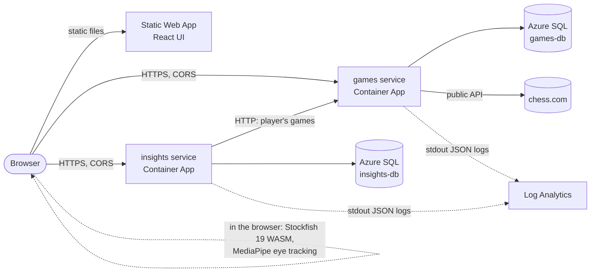

# Chess Habits

Game review shows **what** you played. Chess Habits shows **how** you play.

When people watch a strong player, they don't ask which move was best; they ask how: *how do you
manage your clock, what do you do after a loss, where do you look first?* Those habits never
show up in a move list or an engine review. Chess Habits measures them across hundreds of your
chess.com games, shows which ones cost you points (with an honest error bar on every finding),
and checks whether a change you make actually sticks. It works the other way round too: a strong
player rarely knows which of their own habits hold them back, and their games can tell them.

You are compared mainly with yourself (your wins against your losses); you can also put your
habits next to a grandmaster of your choice. Eye tracking ("where do you look?") is the long-term
goal; a first prototype runs in the browser.

See [docs/vision.md](docs/vision.md) for the idea in full, the habits it covers and the open
research questions.

## What it does today

1. Track a chess.com account and import its full game history (month by month, cached).
2. Run analyses across all games, per time control: a **clock profile** (how often you get into time trouble, from which move, whether it is self-inflicted, whether long thinks, the opening or a steady drain cause it, and how many won positions the clock took) and an **after-loss** card (do you requeue faster, do you play below your level, would a stop-loss rule help). Every comparison comes with its sample size, a 95% interval, the smallest effect the data could detect, and a correction for testing many things at once; Chess Habits says "not enough data" instead of guessing.
3. Show every result as a big tile (icon, headline number, how sure it is); click a tile for the full card with its charts and suggestions.
4. Turn a suggestion into a **rule** with one click (a clock checkpoint such as "keep 30% of my time at move 20", or a stop-loss rule such as "stop after two losses in a row") and see on a rule card whether you keep it more often than before.
5. **Compare with a grandmaster**: pick one (for example Hikaru), Chess Habits imports their last
   12 months of public games and shows your habits next to theirs, per time control: how often
   each of you gets into time trouble, whether it is self-inflicted, what the clock costs, how you
   react to a loss. Every difference has a 95% interval and a verdict ("clearly different", "no
   clear difference").
6. **More habits with charts**: the first game of a session, time of day (in your time zone),
   clock used in each opening, premoves, form by month; the clock card shows your clock move by
   move in wins and losses.
7. **Your plan**: every habit with clear evidence, ranked by how many Elo it costs over an average
   game, with one thing to do and the matching rule to adopt.
8. **Deep analysis in your browser**: Stockfish 19 (WebAssembly) reads your games on your own
   computer and uploads compact results. It powers **critical moments** (when only one move
   holds, how often you find it, by the kind of move and by clock), **how your games end**
   (resignations, draws and time losses judged by the engine) and the **opening autopilot**
   (how fast you play positions you know vs new ones). Missed positions are shown as boards.
9. **Where you look** (prototype): webcam eye tracking in the browser while you solve positions
   you got wrong in your own games. The video never leaves the page.

What comes next: [docs/roadmap.md](docs/roadmap.md). What changed in each version:
[CHANGELOG.md](CHANGELOG.md).

## Screenshots

**Home page:** tracked accounts and grandmasters to compare with, each with its headline finding.


**Habit tiles:** one tile per habit for a time control, with the headline number and how sure
the finding is.


**A habit in full:** the time trouble page, with its causes, clock tables and a suggested rule.


**Grandmaster comparison:** your habits next to Hikaru Nakamura's, each with a 95% interval and a
verdict.


Taken locally with `docker compose` on 2,872 real games from chess.com account `chrisaxm` and
5,745 of Hikaru's games from the last 12 months.

**Live URL:** https://polite-mud-0c720f303.6.azurestaticapps.net (deployed by the pipeline
from `main`, see [docs/deployment.md](docs/deployment.md)). The services scale to zero, so the
first request after a quiet period can take 30–90 s.

## Architecture



| Part | Tech | Owns |
|---|---|---|
| [services/games](services/games) | Python 3.12, FastAPI, SQLAlchemy, Alembic | tracked accounts (CRUD), imported games |
| [services/insights](services/insights) | Python 3.12, FastAPI, SQLAlchemy, Alembic | analysis runs, findings, rules, deep-analysis results uploaded by the browser |
| [ui](ui) | React, Vite, TypeScript; Stockfish 19 lite (WASM) and chess.js for the deep analysis, MediaPipe for the eye-tracking prototype, all in the browser | static UI |
| [infra](infra) | Bicep | all Azure resources |

Each service has its own database and applies its own versioned migrations on startup. If one
service (or chess.com) is down, the other keeps working and the UI shows a clear message.

## Run locally

Requires Docker.

```bash
cp .env.example .env          # set MSSQL_SA_PASSWORD (letters + digits, upper/lower/digit)
docker compose up --build
```

UI: http://localhost:5173 · games API: http://localhost:8001/docs · insights API: http://localhost:8002/docs

Without Docker, each service also runs on SQLite (from the repo root, with a virtualenv that has
both services' `requirements.txt` installed):

```bash
(cd services/games    && uvicorn app.main:app --port 8001) &
(cd services/insights && uvicorn app.main:app --port 8002) &
(cd ui && npm ci && npm run dev)
```

Details: [services/games](services/games/README.md), [services/insights](services/insights/README.md)
and [ui](ui/README.md).

## Tests

```bash
cd services/games    && pip install -r requirements-dev.txt && pytest --cov
cd services/insights && pip install -r requirements-dev.txt && pytest --cov
cd ui && npm ci && npm run test:coverage
```

CI ([ci.yml](.github/workflows/ci.yml)) runs lint, format checks, tests with a 70% coverage gate,
dependency audits, image builds and a full `docker compose` smoke test on every pull request.

## Deploy

Every merge to `main` deploys automatically ([deploy.yml](.github/workflows/deploy.yml)): images
tagged with the commit SHA, Container Apps updated, health checked, UI uploaded, live smoke test.
Reproduce the Azure setup: [docs/deployment.md](docs/deployment.md).

## Documentation

| File | Contents |
|---|---|
| [docs/vision.md](docs/vision.md) | Product vision, design principles, research questions |
| [docs/roadmap.md](docs/roadmap.md) | What comes next, until the deadline and after the course |
| [CHANGELOG.md](CHANGELOG.md) | What changed in each release |
| [docs/assignment.md](docs/assignment.md) | Assignment requirements as a checklist |
| [docs/decisions.md](docs/decisions.md) | Architecture decision records |
| [docs/security.md](docs/security.md) | Security scans in CI and how to handle a finding |
| [docs/data-model.md](docs/data-model.md) | Entities and relationships |
| [docs/definitions.md](docs/definitions.md) | Every metric and statistical rule the analyses use |
| [docs/deployment.md](docs/deployment.md) | Azure resources, secrets, pipeline, rollback |
| [docs/monitoring.md](docs/monitoring.md) | Logs, dashboard queries, SLO |
| [docs/scrum/](docs/scrum/) | Team and roles, Definition of Done, sprint notes |
| [docs/research/](docs/research/) | Research notes on candidate analyses |
| [AI_USAGE.md](AI_USAGE.md) | Log of AI-assisted work |
| [AGENTS.md](AGENTS.md) | Guide for AI coding agents working in this repo |

## Team

Group 3. Roles rotate every sprint; full table and who owns what: [docs/scrum/team.md](docs/scrum/team.md).

| Name | GitHub |
|---|---|
| Christoph Rintz | [@christophrrrrr](https://github.com/christophrrrrr) |
| Javi | [@javocruz](https://github.com/javocruz) |
| Nika | [@nika140906](https://github.com/nika140906) |
| Laura | [@Palee222](https://github.com/Palee222) |
| Zaid | [@zaid-ju](https://github.com/zaid-ju) |
| Xander | [@xanman04](https://github.com/xanman04) |
