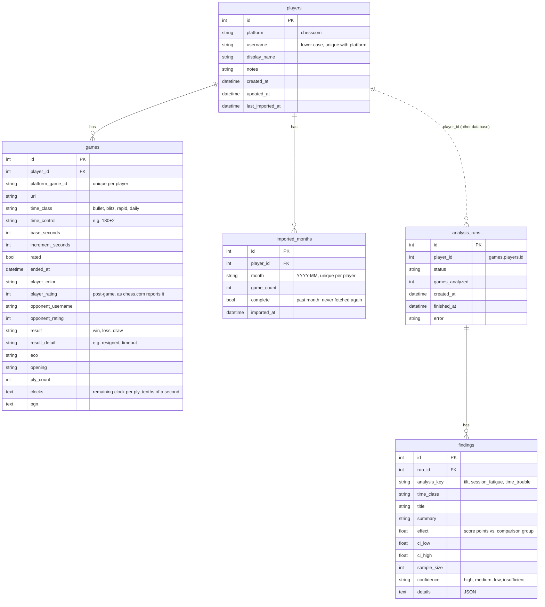

# Data model

Two databases, one per service. There are no foreign keys across services: `analysis_runs.player_id`
refers to `players.id` in the games database by value only.

Schema source of truth: the migrations in
[services/games/migrations/versions](../services/games/migrations/versions) and
[services/insights/migrations/versions](../services/insights/migrations/versions).

Deleting a player deletes their games and imported months (`ON DELETE CASCADE`). Deleting a run
deletes its findings.
