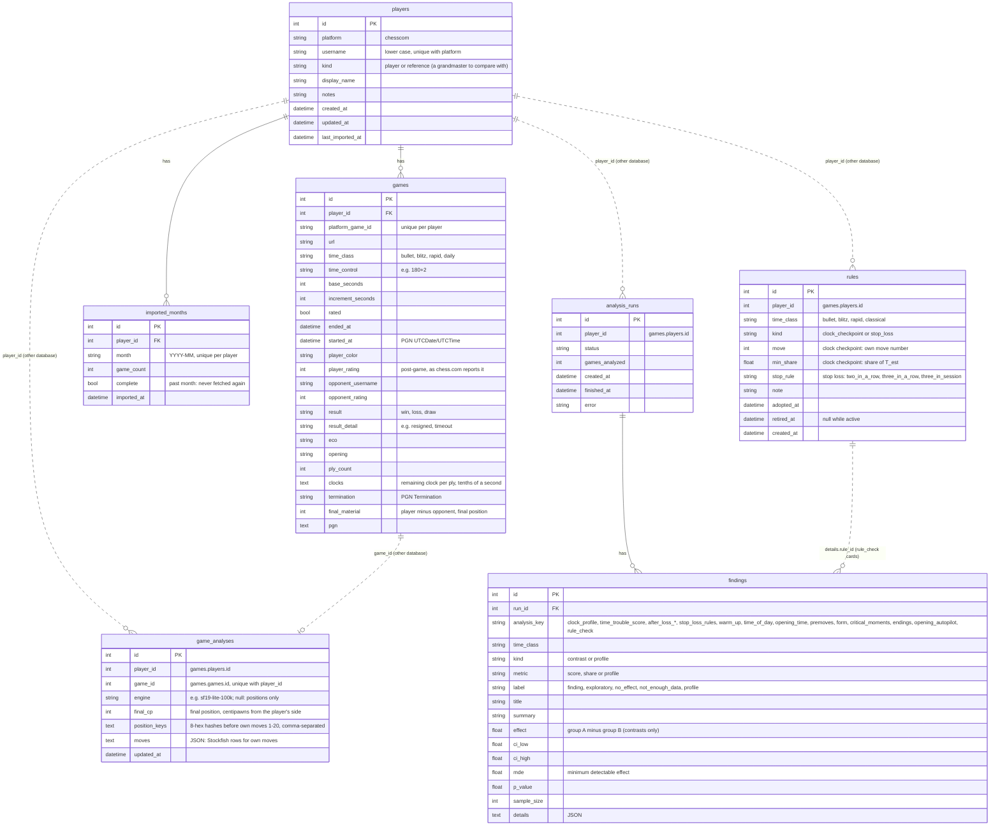

# Data model

Two databases, one per service. There are no foreign keys across services: `analysis_runs.player_id`
refers to `players.id` in the games database by value only.

Schema source of truth: the migrations in
[services/games/migrations/versions](../services/games/migrations/versions) and
[services/insights/migrations/versions](../services/insights/migrations/versions).

Deleting a player deletes their games and imported months (`ON DELETE CASCADE`). Deleting a run
deletes its findings. A rule is never deleted by a run: retiring it (`retired_at`) keeps its
history, and each run writes one `rule_check` finding per active rule.

`game_analyses` (migration 0004) holds the deep analysis that the player's browser computes and
uploads (positions, Stockfish rows, final evaluation; see decision 9). The insights service never
computes it itself; each analysis run reads it next to the games from the games service.
